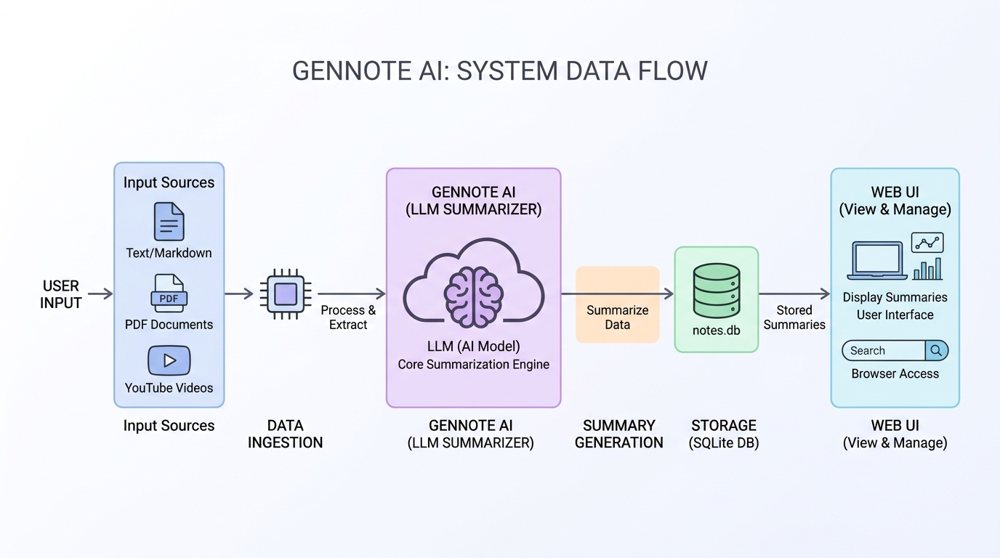

# GenNote AI



## Overview
GenNote AI is an intelligent note‑taking and summarization platform powered by advanced generative AI models. It captures user input, extracts key ideas, and produces concise, well‑structured notes with optional visual enhancements.

## Features
- **AI‑generated summaries**: Transform lengthy text, articles, or transcripts into clear bullet‑point notes.
- **Multimodal support**: Accept plain text, PDFs, and YouTube transcripts.
- **Live collaboration**: Share notes in real‑time with teammates.
- **Export options**: Download notes as Markdown, PDF, or JSON.
- **Custom prompts**: Tailor the summarization style (formal, casual, academic, etc.).

## Quick Start (Windows)
```powershell
# Clone the repository
git clone https://github.com/dhevamithra2006/GenNote-AI.git
cd GenNote-AI

# Set up a virtual environment
python -m venv .venv
.venv\Scripts\activate

# Install dependencies
pip install -r requirements.txt

# Run the application
python app.py
```
The app will start a local server at `http://localhost:8000`.

## Usage
1. Open the web UI.
2. Paste or upload the content you want summarized.
3. Choose a summarization style and click **Generate**.
4. Review, edit, and export the resulting note.

## Project Structure
```
GenNote-AI/
├─ app.py                # FastAPI server entry point
├─ requirements.txt      # Python dependencies
├─ README.md             # This file
├─ notebooks/            # Example Jupyter notebooks
├─ utils/
│   ├─ summarizer.py     # Core summarization logic
│   ├─ pdf_loader.py     # PDF parsing utilities
│   └─ youtube_loader.py # YouTube transcript fetcher
└─ static/
    └─ styles.css        # UI styling
```

## Contributing
We welcome contributions! Please fork the repo, create a feature branch, and submit a pull request. Follow the coding style guidelines and ensure all tests pass.

## License
This project is licensed under the MIT License.

---
*Developed by **Priyanka K** and **Dhevamithra S**.*

